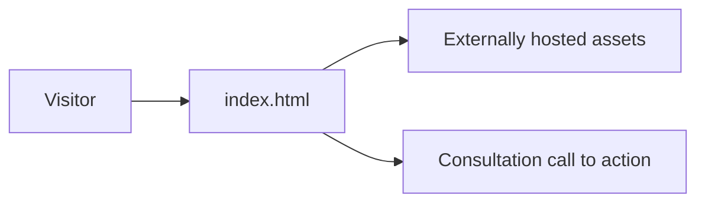

# Cranium · Galelai

What if an AI automation studio had to earn your trust before asking for a call? This fictional agency concept makes the pitch concrete with service examples and a consultation path, all in a compact Framer-exported page. It’s a static design exercise, so fork the layout or swap in your own service story. Review the setup instructions and architecture below, or fork the repository to adapt the implementation to your requirements.

*Click preview above to watch recorded interface demo.*

## Explore the concept

Open the [hosted landing page](https://galelai.vercel.app) or open [index.html](index.html) in a browser. The page is a Framer export and uses externally hosted assets. [oldindex.html](oldindex.html) is the earlier revision.

The agency, project examples, and marketing claims on the page are part of the fictional pitch.

## Page structure

This is a static Framer export with no application server or working consultation backend. The hosted page and local file view are presentation demos.
