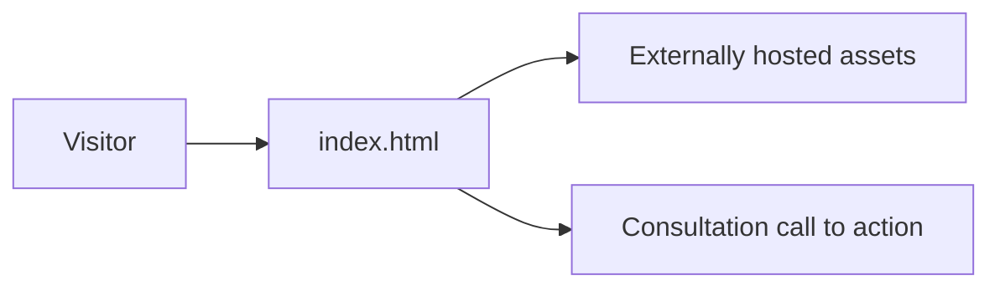

# Cranium · Galelai

A fictional AI automation agency website demonstrating how to explain a service, show examples, and guide visitors to a consultation.

## Explore the concept

Open the [hosted landing page](https://galelai.vercel.app) or open [index.html](index.html) in a browser. The page is a Framer export and uses externally hosted assets. [oldindex.html](oldindex.html) is the earlier revision.

The agency, project examples, and marketing claims on the page are part of the fictional pitch.

## Page structure

This is a static Framer export with no application server or working consultation backend. The hosted page and local file view are presentation demos.
