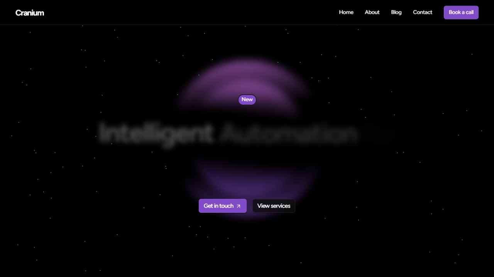

# Galelai · Cranium Studio

> **AI automation agency concept showcase and service architecture portal.**

[](media/walkthrough.mp4)

*Click the preview card above to watch the interactive walkthrough.*

---

## Why I Built This

Demonstrating the value of AI automation requires more than code snippets—clients need to see how autonomous workflows, CRM syncing, and LLM integrations directly solve business bottlenecks.

Galelai / Cranium is an editorial agency presentation site showcasing specialized automation capabilities, transparent project scopes, and an interactive discovery booking funnel.

## Standout Features

- **Editorial Dark Aesthetic:** Sophisticated typography with smooth interactive layout elements.
- **Comprehensive Service Matrix:** Clear architectural breakdowns of autonomous workflows and data sync pipelines.
- **Client Discovery Funnel:** Streamlined intake workflow designed for enterprise workflow audits.

## Media & Visuals

- **Captured Interface:** `media/overview.png`
- **Recorded Walkthrough:** `media/walkthrough.mp4`

## Running Locally

```bash
git clone https://github.com/Invictine/Galelai.git
cd Galelai
npx serve .
```
